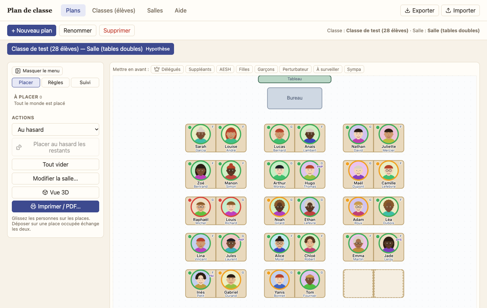
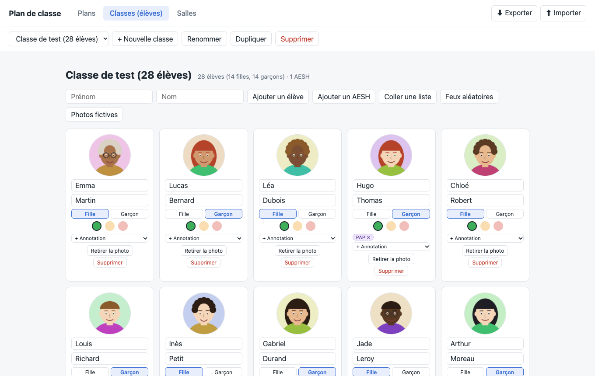
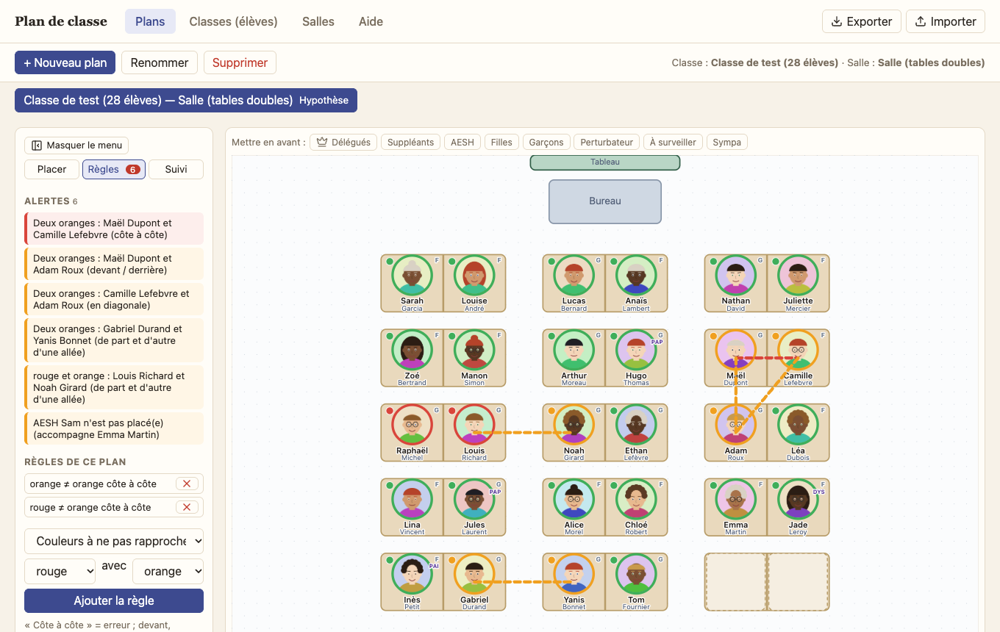

# Plan de classe

Application web pour préparer des plans de classe : élèves avec photos, salles modulables, feu tricolore, AESH, règles de proximité, hypothèses à tester, impression. Tout reste dans le navigateur (aucun serveur, aucune donnée envoyée).

- **Utiliser** : https://gramsco.github.io/plandeclasse/
- **Guide d'utilisation** (installation, sécurité des données…) : [docs/guide.md](docs/guide.md)



<p>
  
  
</p>

## Sécurité

Voir [SECURITY.md](SECURITY.md) : signalement d'une faille et contrôles automatisés (Dependabot, Trivy, CodeQL, Scorecard).

## Développement

Voir [CONTRIBUTING.md](CONTRIBUTING.md) (règles du projet, en anglais) et [docs/ARCHITECTURE.md](docs/ARCHITECTURE.md).

```bash
npm install
npm run hooks:install   # hook git : lance `npm run check` avant chaque commit
npm run dev             # http://localhost:5173
npm run check           # typecheck, lint, langue du code, formatage, tests
npm run build           # build de production (PWA) dans dist/
npm run preview         # sert dist/ — nécessaire pour tester le service worker
```

Le code, les commentaires et les messages de commit sont en anglais ; l'interface et le guide sont en français.
