# Plan de classe — Guide d'utilisation

Plan de classe sert à préparer le placement des élèves dans une salle : photos, noms, feu tricolore, AESH, règles de proximité, plusieurs hypothèses à tester, impression.

**Tout reste sur votre ordinateur.** Aucun compte, aucun serveur, aucune donnée envoyée sur Internet (voir [la section sécurité](#sécurité-et-confidentialité-des-données)).

## Sommaire

1. [Les trois notions à connaître](#les-trois-notions-à-connaître)
2. [Installation](#installation)
3. [Premiers pas](#premiers-pas)
4. [Les classes (les élèves)](#les-classes-les-élèves)
5. [Les salles (le lieu)](#les-salles-le-lieu)
6. [Les plans : placer, vérifier, tester](#les-plans--placer-vérifier-tester)
7. [Imprimer](#imprimer)
8. [Sauvegarder et transférer ses données](#sauvegarder-et-transférer-ses-données)
9. [Sécurité et confidentialité des données](#sécurité-et-confidentialité-des-données)
10. [Questions fréquentes](#questions-fréquentes)
11. [Raccourcis clavier](#raccourcis-clavier)
12. [À propos de cet outil et de l'intelligence artificielle](#à-propos-de-cet-outil-et-de-lintelligence-artificielle)

---

## Les trois notions à connaître

Un plan de classe, c'est une **classe** placée dans une **salle**. L'application garde ces trois choses séparées :

| Notion | C'est quoi ? | Exemple |
|---|---|---|
| **Classe** | La liste des élèves (et des AESH) avec leurs photos | « 6e A », 28 élèves |
| **Salle** | Le lieu physique : tables, bureau, nombre de places | « Salle 12 », tables doubles |
| **Plan** | Une classe placée dans une salle, avec ses règles et ses notes | « 6e A en salle 12 — hypothèse 2 » |

Conséquences pratiques : une même classe peut avoir plusieurs plans (salles différentes, ou plusieurs essais dans la même salle), et une même salle peut servir à plusieurs classes. Déplacer un élève ne bouge pas les tables, et déplacer une table ne touche pas à la liste des élèves.

---

## Installation

Ouvrez **https://gramsco.github.io/plandeclasse/** dans votre navigateur. C'est tout : vous pouvez déjà vous en servir.

Ce site ne fait que *fournir le programme*. Vos élèves et vos photos n'y sont jamais envoyés : ils restent dans votre navigateur.

### L'installer comme une application (facultatif, conseillé)

L'application est une « PWA » : vous pouvez l'installer pour l'ouvrir comme un programme normal, dans sa propre fenêtre, et **elle fonctionne alors sans connexion Internet** (après le premier chargement).

| Navigateur | Comment installer |
|---|---|
| **Chrome** (ordinateur) | Cliquez sur l'icône d'installation ⊕ à droite de la barre d'adresse, puis « Installer ». Sinon : menu ⋮ → « Caster, enregistrer et partager » → « Installer Plan de classe ». |
| **Edge** (ordinateur) | Menu … → « Applications » → « Installer ce site en tant qu'application ». |
| **Safari** (Mac) | Menu Fichier → « Ajouter au Dock ». |
| **iPad / iPhone** (Safari) | Bouton Partager → « Sur l'écran d'accueil ». |
| **Android** (Chrome) | Menu ⋮ → « Installer l'application ». |
| **Firefox** (ordinateur) | Firefox ne propose pas l'installation. L'application marche très bien dans un onglet, y compris hors ligne une fois chargée. |

> **Important :** les données sont propres à chaque navigateur et à chaque adresse. Si vous installez l'application dans Chrome, puis l'ouvrez dans Firefox, vous y trouverez une application vide. Pour passer d'un endroit à l'autre, utilisez [Exporter / Importer](#sauvegarder-et-transférer-ses-données).

Le code source, et la façon de faire tourner l'application sur votre propre ordinateur, sont sur [GitHub](https://github.com/gramsco/plandeclasse).

### Mises à jour

Quand une nouvelle version est disponible, un bandeau apparaît en bas de l'écran : **« Mettre à jour »**. Rien n'est jamais installé sans votre accord, donc jamais en plein travail. Vos données sont conservées ; si le format des données a changé, elles sont converties automatiquement et une copie de sécurité de l'ancien état est gardée. Cliquez sur le numéro de version, en bas de page, pour lire les **notes de version**.

---

## Premiers pas

À l'ouverture, l'application vous propose de créer votre premier plan.

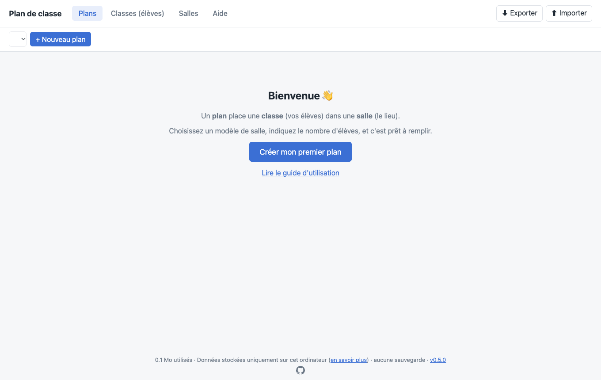

Cliquez sur **Créer mon premier plan**. Deux choix à faire :

- **La classe** : choisissez une classe existante, créez-en une (nom + nombre d'élèves, que vous renommerez ensuite), ou prenez la **classe fictive de test** de 28 élèves avec photos dessinées, pour essayer sans rien saisir.
- **La salle** : choisissez parmi les modèles (tables doubles, îlots de 4, tables individuelles, en U, salle vide). **L'aperçu de la forme s'affiche** pour vérifier avant de valider.

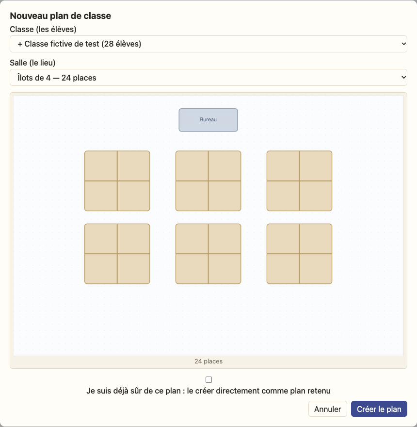

Vous arrivez sur le plan, prêt à remplir.

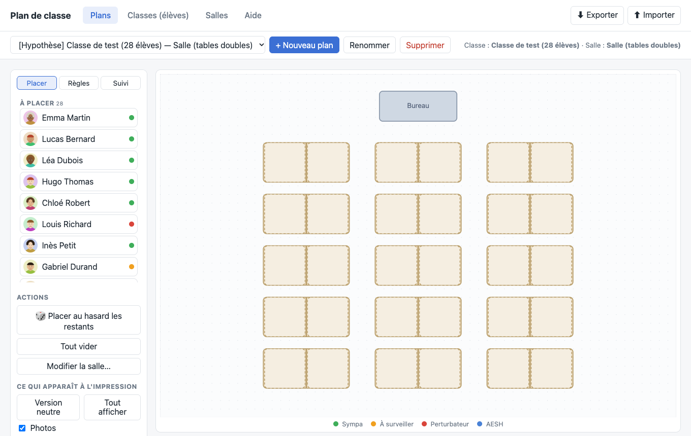

Pour placer : **glissez chaque élève de la liste « À placer » sur une place**. Vous pouvez aussi cliquer sur « 🎲 Placer au hasard les restants ».

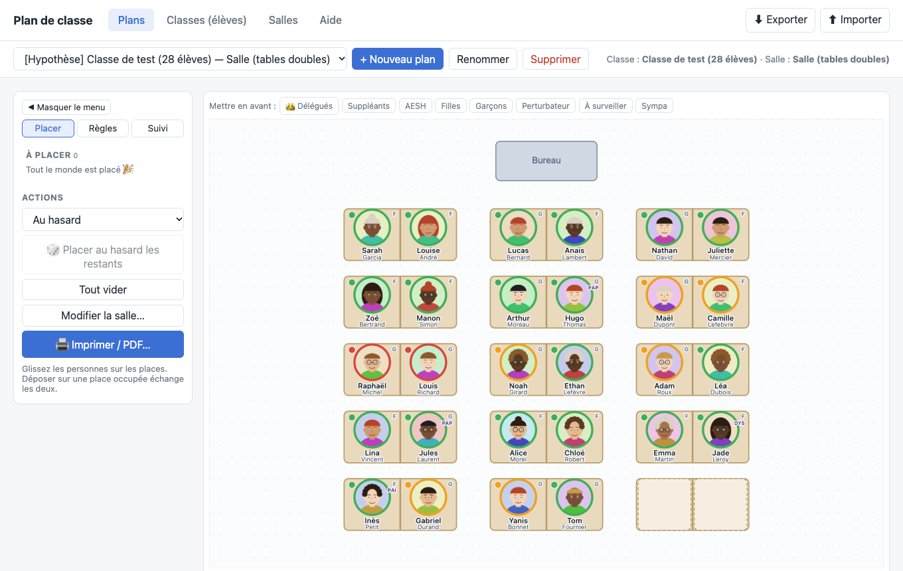

Sur une carte : l'**anneau coloré** est le feu tricolore, la lettre en haut à droite est le genre (F / G) et les mentions violettes sont les annotations (PAP, DYS…). Glisser un élève sur une place occupée **échange** les deux élèves. Glisser un élève dans la liste de gauche le retire de sa place.

---

## Les classes (les élèves)

Onglet **Classes (élèves)**.

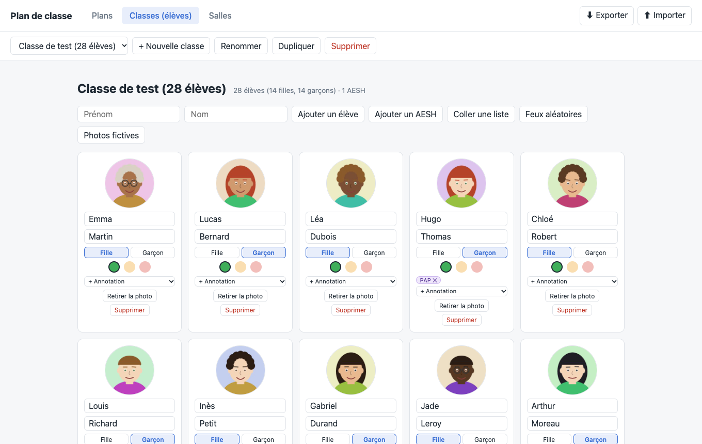

Pour chaque élève, vous pouvez :

- **Photo** : cliquez sur le rond ou glissez-y une image depuis votre ordinateur. La photo est recadrée en carré et réduite (≈ 200 px) : elle reste légère. Sans photo, un avatar neutre s'affiche ; **Avatar au hasard** dessine un personnage à la place.
- **Prénom et nom**.
- **Genre** : Fille ou Garçon (facultatif ; recliquez pour retirer).
- **Délégué** : le bouton 👑 ajoute une couronne à l'élève sur le plan.
- **Feu tricolore** : 🟢 sympa, 🟠 à surveiller, 🔴 perturbateur.
- **Annotations** : PAP, PPS, PAI, PPRE, DYS, HPI, UPE2A, TDAH, ou un libellé de votre choix (« Autre… »).

Pour ajouter beaucoup d'élèves d'un coup, utilisez **Coller une liste** : une ligne par élève, au format « Prénom Nom » ou « Nom, Prénom ».

Les boutons **Photos fictives** et **Feux aléatoires** servent uniquement à faire des essais ; le second remplace les feux de toute la classe (1-2 rouges, 5-6 oranges, le reste vert).

### Les AESH

**Ajouter un AESH** crée une personne qui n'est pas un élève. Choisissez les élèves qu'elle accompagne :

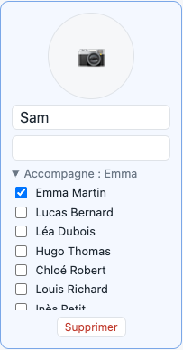

Un AESH se place comme un élève, sur une place libre ou sur une « chaise d'adulte » (à ajouter dans l'éditeur de salle). On peut faire un plan sans l'AESH, mais **un avertissement vous le signale** pour ne pas l'oublier : AESH non placé, ou placé trop loin d'un de ses élèves.

---

## Les salles (le lieu)

Onglet **Salles**. Vous y créez et modifiez les salles ; un plan se contente de les utiliser.

- **Ajouter** une table individuelle, une table double, un îlot de 4, une chaise d'adulte ou le bureau du prof.
- **Déplacer** en glissant. Les tables s'aimantent entre elles et à la grille ; gardez **Alt** enfoncé pour les placer librement.
- **Pivoter** (touche R), **dupliquer**, **supprimer**.
- Sur les tables doubles et les îlots, un **trait** sépare les places : ce sont en réalité des tables individuelles regroupées.
- La taille de la salle se règle en bas du panneau.

### Déplacer plusieurs tables à la fois

Tracez un **rectangle** sur le fond pour sélectionner plusieurs tables :

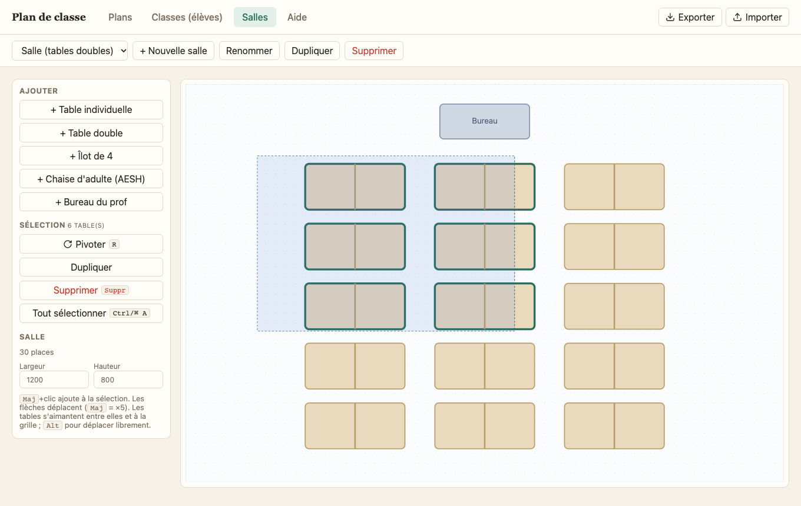

Les tables sélectionnées se déplacent ensemble, avec aimantation du groupe entier. **Maj + clic** ajoute ou retire une table de la sélection ; **Ctrl/⌘ A** sélectionne tout ; les **flèches** déplacent la sélection (Maj = ×5).

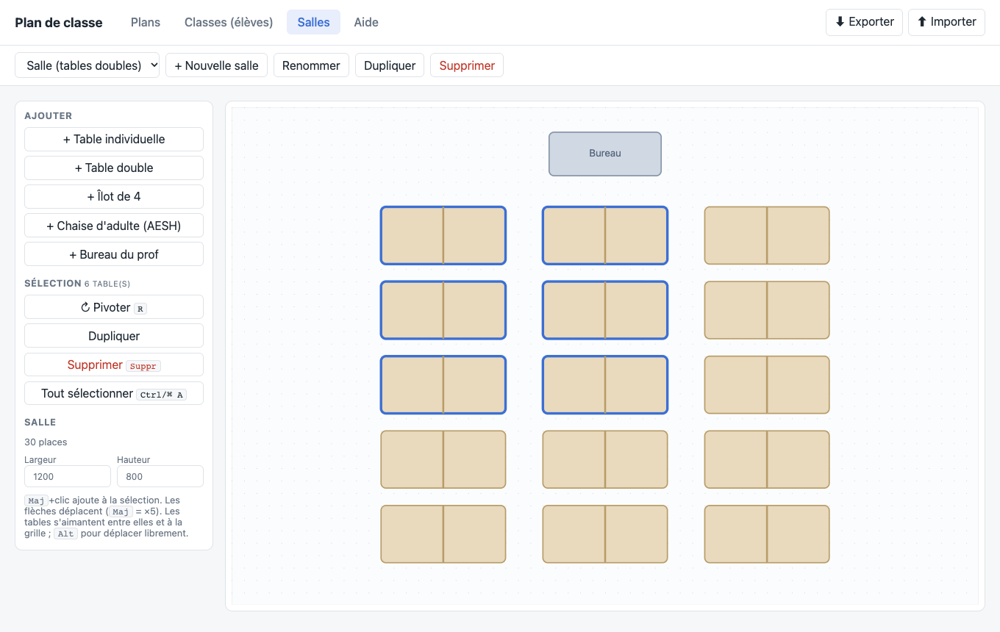

Si vous modifiez une salle, les plans qui l'utilisent se mettent à jour. Les élèves placés sur une table supprimée redeviennent « à placer ».

---

## Les plans : placer, vérifier, tester

Onglet **Plans**. Le panneau de gauche a trois onglets : **Placer**, **Règles** et **Suivi**. Le bouton **« Masquer le menu »** le replie pour donner toute la largeur au plan (recliquez sur ▶ pour le rouvrir).

### Placer au hasard, ou presque

Dans **Placer**, choisissez une façon de répartir les personnes qui n'ont pas encore de place, puis **Placer au hasard les restants** :

- **Au hasard** ;
- **Alterner filles / garçons** (pour les élèves dont le genre est renseigné) ;
- **Répartir les couleurs (tricolore)** : évite de rapprocher les élèves rouges et oranges.

Les personnes déjà placées ne bougent pas.

### Appliquer un plan à une autre salle

**Appliquer à la salle…** crée une nouvelle hypothèse dans la salle choisie, en gardant le plan d'origine. Chaque élève est placé à l'endroit le plus proche de sa place d'origine (en proportion de la taille de la salle), même si les tables sont disposées autrement. S'il manque des places, les élèves en trop restent dans « À placer ».

### Règles et alertes

Dans **Règles**, vous écrivez ce qui est à éviter pour *ce* plan :

- **Séparer des élèves** : cochez autant d'élèves que vous voulez, ils seront séparés les uns des autres ;
- **Couleurs à ne pas rapprocher** (par exemple rouge avec rouge) ;
- **Un élève change de couleur près d'un autre** (un vert devient orange près de tel élève : le feu s'affiche alors avec un ▲).

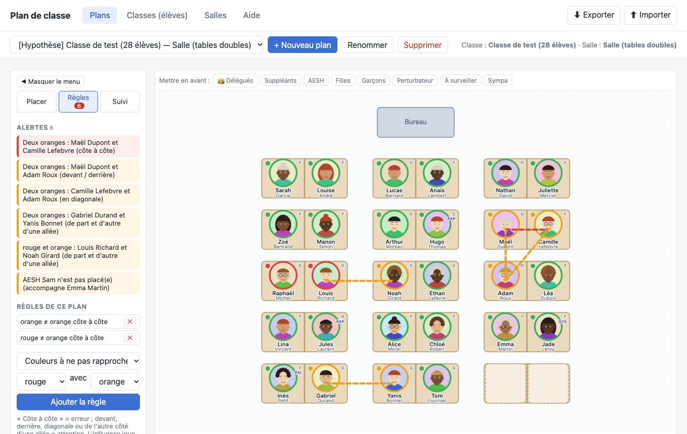

Les alertes apparaissent à gauche, et des traits relient les élèves concernés sur le plan :

- **Rouge (erreur)** : côte à côte, ou AESH trop loin de son élève.
- **Orange (attention)** : devant ou derrière, en diagonale, ou de l'autre côté d'une allée ; AESH non placé.
- **Bleu (info)** : un feu a changé à cause d'une règle.

**Survolez une règle ou une alerte** : les élèves concernés restent bien visibles, les autres s'estompent. Au-dessus du plan, les boutons **Mettre en avant** (délégués, AESH, filles, garçons, couleurs) font la même chose ; recliquez pour désactiver. Rien de cela n'est imprimé.

Les règles sont propres à chaque plan et se copient avec lui. Les traits d'alerte ne sont **jamais imprimés**.

### Hypothèses : essayer, éprouver, recommencer

Un plan est une **hypothèse** à tester dans la vraie classe. Dans l'onglet **Suivi** :

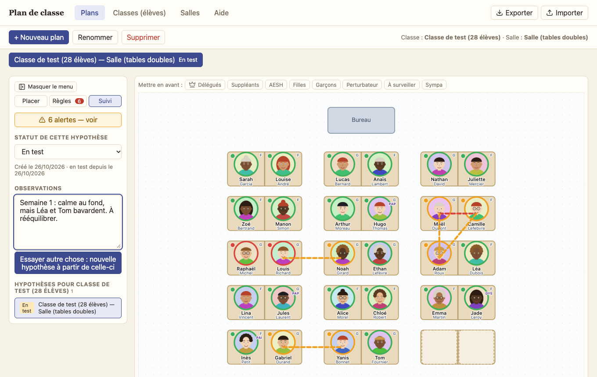

1. Donnez-lui un **statut** : *Hypothèse*, *En test*, *Retenu* ou *Abandonné*. Un plan retenu s'affiche avec ✓. Si vous êtes déjà sûr de votre plan, cochez « Je suis déjà sûr de ce plan » en le créant : il est directement retenu.
2. Notez vos **observations** (ce que ça donne en vrai).
3. Si ça ne tient pas, cliquez sur **« Essayer autre chose »** : une copie (places et règles) est créée comme nouvelle hypothèse, liée à la précédente. Modifiez-la sans risque.

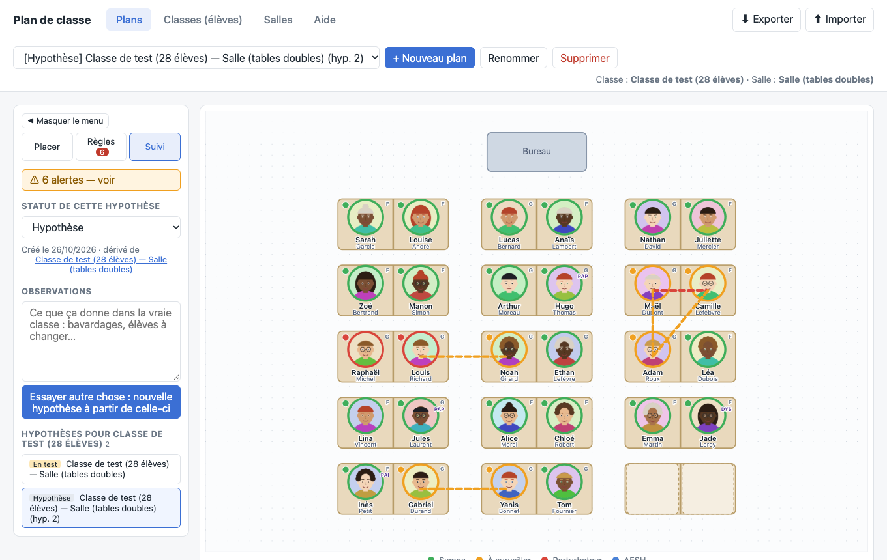

La liste en bas permet de passer d'une hypothèse à l'autre et de garder un historique de ce que vous avez essayé.

---

## Imprimer

Dans l'onglet **Placer**, la section **« Ce qui apparaît à l'impression »** vous laisse choisir : photos, prénoms, noms, couleurs, annotations, genre, délégués.

- **Version neutre** : photos et noms uniquement, sans couleurs ni annotations ni genre. À utiliser pour un plan **affiché en classe**, que les élèves peuvent lire.
- **Tout afficher** : version complète pour vous.
- **Aperçu à l'écran** : montre ces choix tout de suite, au lieu de seulement à l'impression.
- **Vue retournée (180°)** : le plan vu depuis le fond de la classe, avec les noms toujours lisibles.

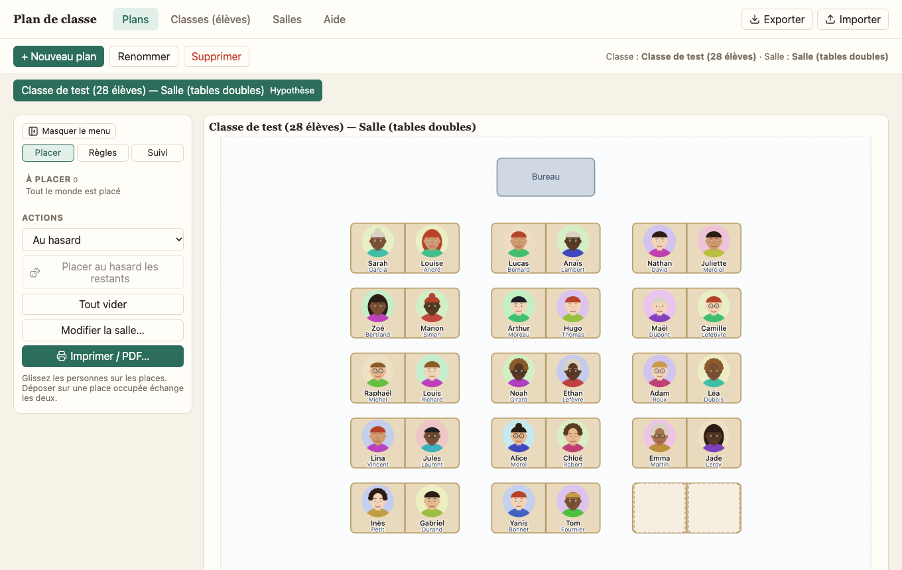

Cliquez sur **Imprimer / PDF**. Dans la fenêtre d'impression, choisissez « Enregistrer au format PDF » pour obtenir un fichier. Le plan est mis en page en A4 paysage, sur une seule page ; **Aperçu à l'écran** a les mêmes proportions que la page imprimée. Vos choix d'affichage sont mémorisés.

---

## Sauvegarder et transférer ses données

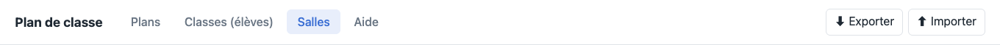

- **⬇ Exporter** crée un fichier `.classe` contenant tout : classes, photos, salles, plans, règles, notes.
- **⬆ Importer** relit un fichier `.classe`. Vous choisissez :
  - **Ajouter** : vos données sont conservées ; ce qui existe déjà dans le fichier est mis à jour ;
  - **Tout remplacer** : efface d'abord ce qui est dans l'application.

L'export sert à **sauvegarder** (les navigateurs peuvent perdre les données, voir plus bas) et à **changer d'ordinateur ou de navigateur**. Le pied de page affiche la date du dernier export et vous prévient si vous n'avez jamais exporté. **Prenez l'habitude d'exporter régulièrement**, par exemple après chaque séance de travail importante.

Les anciens fichiers restent lisibles : ils sont convertis à l'import. Un fichier créé par une version *plus récente* de l'application est refusé avec un message qui explique pourquoi.

---

## Sécurité et confidentialité des données

### Où sont mes données ?

Dans votre navigateur, sur votre appareil, dans une base appelée IndexedDB (le même mécanisme que celui qu'utilisent de nombreux sites pour fonctionner hors ligne). Il n'y a **ni serveur, ni compte, ni base de données en ligne**.

### Est-ce que quelque chose est envoyé sur Internet ?

Non. L'application :

- n'envoie **aucune** donnée (pas de statistiques, pas de suivi, pas de publicité) ;
- n'utilise **aucune ressource externe** : ni police, ni bibliothèque, ni image chargée depuis un autre site ;
- applique une politique de sécurité (`Content-Security-Policy`) qui **interdit au navigateur** de charger ou de contacter autre chose que sa propre adresse.

Vous pouvez le vérifier vous-même : ouvrez les outils de développement du navigateur (F12), onglet **Réseau**, et utilisez l'application. Vous ne verrez aucune requête sortante avec vos données.

### Et avec la version en ligne (GitHub Pages) ?

Le site est hébergé par GitHub, qui ne fait que **distribuer le programme** (des fichiers identiques pour tout le monde). Vos données n'y transitent pas. Comme pour tout site web, l'hébergeur peut voir que votre adresse IP a chargé la page ; il ne voit rien de ce que vous saisissez. Le code source est public : c'est le programme, pas vos données.

### Ce que l'application ne fait pas

Soyons clairs sur les limites :

- **Les données ne sont pas chiffrées** par l'application. Toute personne qui a accès à votre session d'ordinateur *ouverte* peut ouvrir l'application et voir les élèves. Verrouillez votre session quand vous vous absentez, et activez le **chiffrement du disque** (FileVault sur Mac, BitLocker sur Windows) si l'ordinateur peut être perdu ou volé.
- **Pas de mot de passe** pour ouvrir l'application ou les fichiers `.classe`.
- **Les fichiers `.classe` sont lisibles en clair**, photos comprises. Traitez-les comme des dossiers d'élèves : ne les envoyez pas par e-mail non sécurisé, ne les laissez pas traîner dans un dossier partagé, supprimez les copies inutiles.
- **Pas de synchronisation** entre appareils : c'est volontaire (rien ne quitte l'appareil), mais cela veut dire que l'export est votre seule sauvegarde.

### Risques de perte de données

Les données peuvent disparaître si vous :

- videz les données du navigateur (« Effacer les données de navigation / des sites ») ;
- utilisez la **navigation privée** (tout est effacé à la fermeture) ;
- désinstallez l'application installée (certains navigateurs proposent d'effacer ses données en même temps) ;
- changez d'adresse ou de navigateur (les données ne suivent pas).

L'application demande au navigateur de ne pas effacer ses données automatiquement, mais ce n'est pas une garantie. **L'export `.classe` est votre vraie sauvegarde.**

### Données d'élèves et protection des données personnelles

Des photos et des noms d'élèves mineurs sont des données personnelles. Garder les données sur votre appareil évite les principaux risques (pas de transfert, pas de sous-traitant, pas d'hébergement), mais **cela ne vous dispense pas** de respecter les règles de votre établissement. Quelques réflexes :

- **Les annotations (PAP, PAI, PPS, DYS…) renseignent sur la santé ou le handicap** : ce sont des informations sensibles. Ne les saisissez que si c'est nécessaire, et utilisez la **version neutre** pour tout ce qui est affiché ou visible des élèves.
- Utilisez de préférence un **appareil professionnel**, ou à défaut un appareil personnel protégé par un mot de passe.
- En cas de doute (photos, durée de conservation, information des familles), rapprochez-vous du **référent à la protection des données** de votre établissement.

*Ce guide décrit le fonctionnement technique de l'application ; il ne constitue pas un avis juridique.*

---

## Questions fréquentes

**J'ai ouvert l'application et mes classes ont disparu.**
Vous êtes probablement sur une autre adresse ou un autre navigateur (Chrome ≠ Firefox, application installée ≠ onglet d'un autre site), ou en navigation privée. Retournez là où vous travailliez, ou importez votre dernier fichier `.classe`.

**Comment passer sur un nouvel ordinateur ?**
Exportez sur l'ancien (⬇ Exporter), copiez le fichier `.classe` (clé USB), importez sur le nouveau (⬆ Importer), puis supprimez le fichier de la clé.

**Un message dit que mes données viennent d'une version plus récente.**
Un ancien exemplaire de l'application est resté en cache. Cliquez sur « Recharger » ; si le message persiste, fermez tous les onglets de l'application et rouvrez-la. Vos données ne sont pas modifiées.

**L'application ne se met pas à jour.**
Fermez et rouvrez l'application, ou attendez la bannière « Mettre à jour » (vérifiée à l'ouverture et toutes les heures).

**Puis-je l'utiliser sans Internet ?**
Oui, une fois la page chargée une première fois (et encore mieux si elle est installée).

**Les photos sont-elles modifiées ?**
Elles sont recadrées en carré et réduites à environ 200 px, en JPEG. L'original n'est pas conservé.

---

## Raccourcis clavier

Dans l'éditeur de salle :

| Touche | Action |
|---|---|
| Clic / rectangle | Sélectionner une ou plusieurs tables |
| **Maj** + clic | Ajouter / retirer une table de la sélection |
| **Ctrl/⌘ A** | Tout sélectionner |
| **R** | Pivoter la sélection |
| **Suppr** | Supprimer la sélection |
| **Flèches** | Déplacer (Maj = ×5) |
| **Alt** (en glissant) | Déplacement libre, sans aimantation |
| **Échap** | Désélectionner |

Dans un plan : **Échap** annule un glisser en cours.

---

## À propos de cet outil et de l'intelligence artificielle

**Cette application a été réalisée avec l'aide d'une intelligence artificielle** : Claude Sonnet 5.5, développé par Anthropic, a servi d'assistant pour écrire le code et ce guide.

**J'en assume pourtant la pleine responsabilité.** L'IA est un outil ; je suis l'auteur et le responsable de ce site : chaque ligne de code publiée ici est sous ma responsabilité, de même que son contenu et ses éventuelles erreurs.

Quelques précisions utiles :

- **L'application n'utilise aucune intelligence artificielle.** Elle ne communique avec aucun service d'IA, et vos données d'élèves ne sont jamais transmises à qui que ce soit (voir [la section sécurité](#sécurité-et-confidentialité-des-données)).
- **Le logiciel est fourni « en l'état », sans garantie.** Vérifiez toujours un plan avant de le mettre en œuvre ou de l'afficher, et gardez des sauvegardes ([export `.classe`](#sauvegarder-et-transférer-ses-données)).
- **Le code est public et surveillé automatiquement** : mises à jour des dépendances, recherche de vulnérabilités et de secrets, analyse statique du code. Le détail est dans la [politique de sécurité](https://github.com/gramsco/plandeclasse/blob/main/SECURITY.md).
- **Une erreur, une faille, une idée ?** Signalez-la sur [GitHub](https://github.com/gramsco/plandeclasse). Pour une faille de sécurité, utilisez le signalement privé décrit dans la politique de sécurité.
