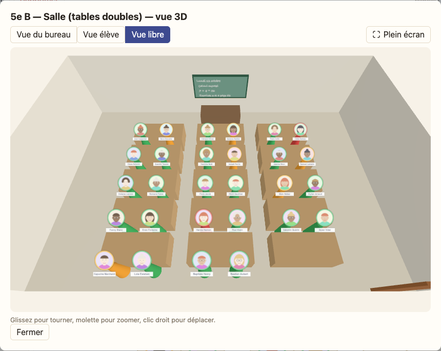

# Notes de version

Ce qui change pour vous, version après version. Vos données restent sur votre ordinateur : pensez à exporter une
sauvegarde avant de mettre à jour.

## 0.15.1 — 2026-11-01

- **Connexion directe** : l'appareil qui rejoint garde son code affiché jusqu'à ce que le premier appareil l'ait lu.
  Avant, il le cachait trop tôt et la connexion restait bloquée sur « Connexion en cours… ».

## 0.15.0 — 2026-11-01

- **Connexion directe entre deux appareils** : « Synchroniser » → « Connexion directe ». Les deux appareils, sur le même
  Wi-Fi, s'échangent deux codes QR pour se reconnaître, puis envoient classes et modifications directement de l'un à
  l'autre, sans serveur ni Internet, autant de fois que vous voulez. Vous choisissez toujours ce qu'il faut appliquer.
  Nouveauté testée avec Chrome sur ordinateur : si un appareil n'arrive pas à se connecter, les codes QR de « Envoyer »
  restent disponibles.

## 0.14.1 — 2026-11-01

- **Plan lisible sur téléphone** : sur un petit écran, le menu de gauche passe au-dessus du plan au lieu de lui prendre
  presque toute la place, et il est replié au départ (le bouton à l'icône ▶ le rouvre) : le plan occupe toute la largeur.

## 0.14.0 — 2026-11-01

- **Installer vos classes sur un autre appareil** : « Synchroniser » → « Envoyer mes classes » affiche vos classes, avec
  leurs plans et leurs salles, sous forme de codes QR ; l'autre appareil les lit avec sa caméra et ajoute celles qu'il
  n'a pas encore. Une classe déjà présente n'est jamais écrasée. Les photos ne sont pas transférées.

## 0.13.0 — 2026-11-01

- **Modifier sur son téléphone, puis reporter sur l'ordinateur** : le bouton « Synchroniser » affiche vos modifications
  (places, feux tricolores, annotations, notes…) sous forme de code QR sur le téléphone, et l'ordinateur les lit avec sa
  caméra. Vous choisissez quelles modifications appliquer. Rien ne passe par Internet.
- **Sur téléphone, la vue 3D n'est plus proposée** : elle est lourde et peu pratique sur un petit écran.

## 0.12.0 — 2026-11-01

- **Se promener dans la classe en 3D** : un nouveau point de vue, depuis le bureau du prof, où l'on marche avec les
  touches Z Q S D (ou W A S D, ou les flèches ; Maj pour courir) et où l'on glisse pour regarder autour de soi. Les
  tables bloquent le passage : on suit les allées.
- **Voir depuis la place d'un élève en un clic** : cliquez directement sur un élève, dans n'importe quelle vue 3D.

## 0.11.0 — 2026-11-01

- **Vue 3D de la classe** : le bouton « Vue 3D » du plan montre la salle en trois dimensions, avec chaque élève sous forme de pion,
  leur photo et leur nom. Au choix : la vue du bureau du prof, la vue depuis la place d'un élève (pour voir ce qu'il voit du
  tableau), ou une vue libre où l'on tourne autour de la salle, en plein écran si vous le souhaitez. Rien n'est chargé tant que vous ne l'ouvrez pas.
  

- **Porte, fenêtres et tableau** : dans l'onglet Salles, ajoutez une porte, une fenêtre ou un tableau (noir ou blanc). En 3D, le tableau porte un exemple de texte écrit à la main. Les nouvelles
  salles modèles ont déjà un tableau et une porte. Un « Aperçu 3D » de la salle est disponible pendant que vous la
  composez. Un petit siège dessiné à côté de chaque place montre de quel côté s'assoit l'élève.

## 0.10.1 — 2026-11-01

- **Élèves modifiables depuis tous les plans** : quand une autre classe était sélectionnée dans l'onglet Classes, la
  fiche d'un élève sur le plan ne modifiait rien. Les modifications (nom, photo, feu, annotations, délégué…)
  s'appliquent maintenant toujours à la classe du plan.

## 0.10.0 — 2026-11-01

- **Édition rapide sur le plan** : la fiche qui s'ouvre en cliquant un élève sur le plan permet maintenant de tout
  modifier (photo, nom, genre, annotations…), pas seulement le feu et le délégué.

## 0.9.1 — 2026-11-01

- **Plusieurs délégués et suppléants** : la limite d'un seul par classe est retirée (classes regroupées), les cases se
  cochent de nouveau librement.
- **Plans rangés comme les classes** : la liste des plans suit l'ordre de vos classes (les plans de la classe 1 avant
  ceux de la classe 2…).
- **Suppression d'un élève confirmée** : l'application demande confirmation avant de supprimer un élève.

## 0.9.0 — 2026-10-26

- **Nouvelle couleur** : l'application passe du vert à l'indigo. Les feux tricolores gardent leurs couleurs.
- **Classes dans l'ordre que vous voulez** : glissez une classe dans la liste de gauche pour la déplacer (ou
  Alt + flèches au clavier). L'ordre est conservé.
- **Note libre sur chaque élève** : un texte que vous seul voyez, jamais dessiné ni imprimé sur le plan. Elle se
  modifie depuis la classe ou depuis le plan.
- **Notes visibles au survol** : passez la souris sur un élève, dans la classe ou sur le plan, pour lire sa note sans
  rien ouvrir.
- **Fiches plus simples** : un clic sur la fiche d'un élève ouvre sa fiche complète, sans « Modifier / Replier » ni
  grille qui se décale.
- **Vue en tableau** : dans la classe, le bouton « Tableau » affiche tous les élèves en lignes, pour modifier d'un
  coup genre, feu, délégué, suppléant, annotations et note.
- **Photo depuis le tableau** : un clic sur la photo d'un élève, dans le tableau, ouvre le choix du fichier.
- **Un seul délégué et un seul suppléant par classe** : en nommer un nouveau remplace le précédent.
- **Impression corrigée** : le plan tient de nouveau sur une seule page (la liste des plans s'imprimait par erreur).

## 0.8.0 — 2026-10-26

- **Fenêtres plus modernes** : plus de boîtes grises du navigateur pour renommer, supprimer ou remplacer. Les
  questions s'affichent dans l'application.
- **Plans et salles comme les classes** : la liste est à gauche, un clic suffit pour passer de l'un à l'autre.
- **Écran d'accueil** : sans plan, « Que voulez-vous faire aujourd'hui ? » propose de créer un plan, une classe ou une
  salle.
- **AESH corrigés** : le bouton « Ajouter un AESH » fonctionne même sans nom, et les AESH ont leur section dans la
  classe.
- **Nouvelle règle « Rapprocher 2 ou 3 élèves »** : l'inverse de « Séparer des élèves ».

## 0.7.0 — 2026-10-26

- **Nouvelle apparence « Papier »** : fond crème, vert profond, titres à empattements. Les couleurs du feu tricolore
  restent les seules couleurs vives.
- **Vraies icônes** : les petits dessins des boutons (exporter, imprimer, couronne…) remplacent les émojis, qui ne
  s'affichaient pas de la même façon selon l'ordinateur.
- **Classe d'un coup d'œil** : chaque élève est une petite fiche (photo, nom, pastilles). Le bouton « Modifier » ouvre
  la fiche complète. Les outils de test (feux et photos fictifs) sont rangés à part.

## 0.6.0 — 2026-10-26

- **Passer d'une classe à l'autre** : la liste des classes est à gauche, et un champ de recherche filtre les élèves par
  nom (accents et majuscules ignorés) en indiquant combien il y en a dans chaque classe.
- **Fiche d'un élève sur le plan** : un clic sur un élève ouvre sa fiche, avec les actions rapides (délégué, suppléant,
  feu tricolore, retirer de sa place).
- **Suppléant** : une couronne argentée pour le suppléant du délégué, sur la fiche, sur le plan et dans les filtres.

## 0.5.0 — 2026-10-26

- **Imprimer / PDF dans une fenêtre** : les options d'impression ne chargent plus le menu. La fenêtre montre un aperçu
  agrandi de quelques élèves, qui suit vos choix en direct.
- **Chercher un élève pour les séparer** : en créant une règle « Séparer », un champ de recherche (sans tenir compte des
  accents ni des majuscules) filtre la liste. Les élèves déjà cochés restent affichés.
- **Menu de gauche** : le menu ne déborde plus et sa barre de défilement est corrigée. Sans photo, l'avatar vide n'a
  plus de marge en trop.

## 0.4.0 — 2026-10-26

- **Mettre des élèves en avant** : en survolant une règle ou une alerte, les élèves concernés restent bien visibles et
  les autres s'estompent. Au-dessus du plan, des filtres rapides (délégués, AESH, filles, garçons, couleurs) font de même.
  Rien de tout cela n'est imprimé.
- **Ouvrir un fichier .classe d'un double-clic** : dans l'application installée (Chrome), un fichier `.classe` s'ouvre
  directement dans l'application, avec le même choix « Ajouter » / « Tout remplacer » que l'import.
- **Mises à jour plus rapides** : l'application installée cherche une nouvelle version toutes les heures et chaque fois
  que vous revenez sur sa fenêtre, au lieu d'attendre une réouverture.

## 0.3.0 — 2026-10-26

### Nouveautés

- **Délégué** : un bouton 👑 sur la fiche de chaque élève, et une couronne sur le plan (option d'impression « Délégués »).
- **Avatar par défaut** : sans photo, un avatar neutre s'affiche. Le bouton « Avatar au hasard » dessine un personnage
  à la place de la photo.
- **Menu de gauche repliable** : le bouton « Masquer le menu » libère toute la largeur pour le plan. Votre choix est
  mémorisé.
- **Appliquer un plan à une autre salle** : « Appliquer à la salle… » crée une nouvelle hypothèse en répartissant au
  mieux les élèves selon leur position dans la salle, même si la configuration est différente. Les élèves qui n'ont pas
  de place restent « À placer ».
- **Placer au hasard, avec des idées** : alterner filles et garçons, ou répartir les couleurs du feu tricolore pour
  éviter de rapprocher les élèves rouges et oranges.
- **Séparer des élèves** : une règle peut maintenant séparer autant d'élèves que vous le souhaitez, les uns des autres.
- **Plan déjà retenu** : à la création d'un plan, cochez « Je suis déjà sûr de ce plan » pour le créer directement
  comme plan retenu.

### Améliorations

- Un plan retenu s'affiche avec ✓ au lieu de « [Hypothèse] ».
- **Impression en paysage** : le plan occupe exactement une page, sans page blanche supplémentaire. L'aperçu à l'écran
  a les mêmes proportions que la page imprimée.
- Le numéro de version, en bas de page, ouvre ces notes de version.
